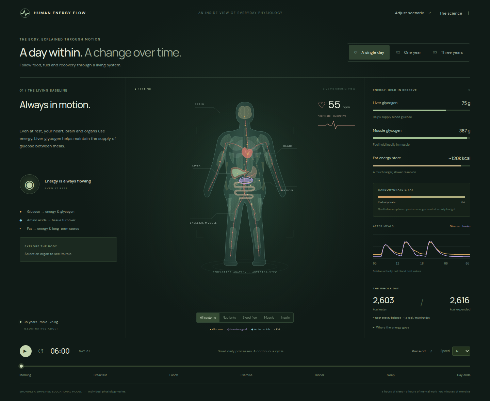
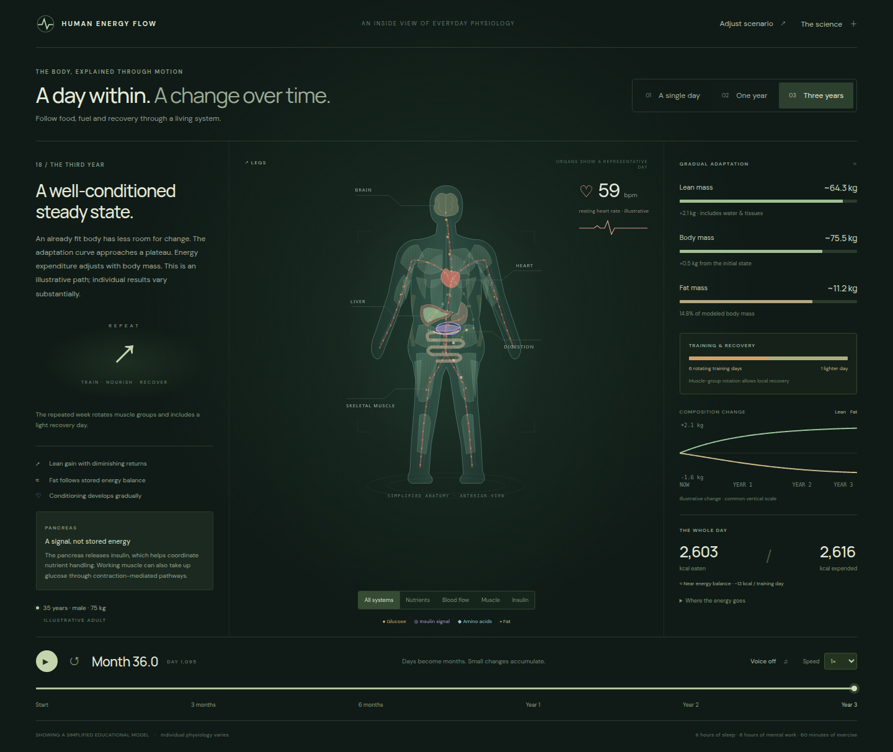
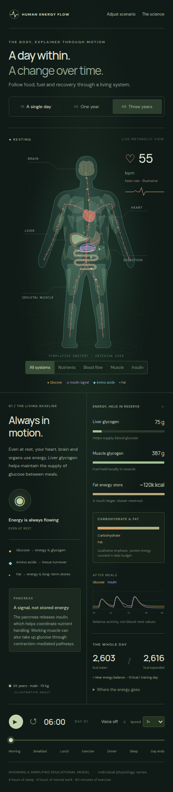

# Human Energy Flow

**An interactive simulation of human metabolism: meals, glucose and insulin, energy stores, exercise, recovery and three years of training adaptation, explained visually for a lay audience.**

**▶ [Try it live](https://sesasa.github.io/human-energy-flow/)**



**Highlights**
- Minute-scale day physiology, sub-second sprint physiology and multi-year adaptation, all driven by real food data (CoFID 2021).
- Diet editor, body-composition presets, a sex-aware profile and lab-marker scenarios (ferritin, B12, folate, vitamin D) with sensitivity bands.
- Narrated, captioned playback synchronized with the charts. Responsive and accessible (reduced motion, keyboard navigation).
- Over ten numerical and Playwright test suites, and a documented source register and model assumptions for every feature.
- Multi-agent workflow: built with OpenAI Codex from a detailed brief ([`codex_human_metabolism_simulation_prompt.md`](codex_human_metabolism_simulation_prompt.md)), with Claude Code giving independent scientific and UX reviews at each revision (see `docs/*/REVIEW.md`).

| Three-year adaptation | Mobile |
|---|---|
|  |  |

**Stack:** TypeScript, Vite, SVG and Playwright. No backend.

> Educational prototype, not a clinical tool.

---

An interactive educational simulation of a healthy adult's metabolism: follow a mixed meal, insulin signaling, energy stores, exercise and recovery through a day, explore 20 sprint/walk intervals in a separate intense-exercise day, and follow gradual adaptation over three years.

## Run locally

Requires Node.js 22+ and npm.

```sh
npm install
npm run dev
```

Open the URL Vite prints.

```sh
npm run build       # type checking + production bundle in dist/
npm run preview     # serve the production build
npm test            # physiology and timeline regression checks
npm run test:browser # Chrome interaction and responsive checks
npm run test:guided # Synchronized narration, plot focus and shared scrubbing
npm run test:composition # Starting-body presets, custom inputs, visuals and export
npm run test:diet   # Food editing, scopes, meals, keyboard access and mobile
npm run test:status # Activity figures, tooltips and selected lab status
npm run test:templates # Template switching, unchanged Healthy, shared foods and both views
npm run test:daily-body # Adapted daily anatomy, matching physiology and intentional tooltips
npm run test:profile # Sex-aware energy/body, menstrual iron, navigation and mobile
npm run test:viewer # Graph dragging, shared timeline, weekday navigation and mobile
npm run test:micronutrients # Lab plots, food edits, ranges, scopes and responsive UI
```

Browser tests default to port 5174 and use `/usr/bin/google-chrome`. Override the URL with `SIM_URL=http://127.0.0.1:5173 npm run test:browser`. Screenshots are saved under `artifacts/`.

## Explore

- Start in **Over Time**. **↗ Show Inside a Day** reveals **Healthy day / Sprint session** and **← Back to Over Time**; the exact long-term position is remembered. The timeline and chart cover all three years without extra top-level duration tabs.
- **Adjust scenario → Sex** selects Male or Female. It updates Mifflin–St Jeor energy estimates, anatomy, corresponding example composition, lean-scaled adaptation, food coverage and relevant laboratory defaults. Custom body measurements stay as entered. Meals remain unchanged so the resulting energy balance is visible.
- **Female → Menstrual cycle** optionally adds editable cycle length, bleeding duration, light/typical/heavy loss, and starting cycle day. The cycle is off by default. Ferritin plots show subtle bleeding-day ticks; periodic red-cell iron loss and gradual replacement affect stores cumulatively. Other markers do not oscillate with this setting. The categories and curves are educational estimates, not measured blood loss or a treatment plan.

- Choose **Adjust scenario → Starting body → Underweight / Fit baseline / Overweight**, then Apply. Presets fill draft mass/composition fields; closing without applying leaves the simulation unchanged. At 175 cm, examples are 55 kg / 12% fat, 75 kg / 17%, and 88 kg / 30%. Meals, activity and fitness stay as configured.
- **Custom** focuses the body fields inside Adjust scenario. Height, weight and body fat have a live lean/fat preview; the anatomy follows later fat/lean changes in Over Time and when exploring the selected body inside a day.
- **Diet → Micronutrients** offers four checkboxes: Ferritin, Vitamin B12, Folate and 25-OH Vitamin D. Enter a result and unit; your laboratory’s supplied limits override linked, clearly labeled defaults. Only selected markers get plots. A dot marks the actual entered value; a dashed line and sensitivity envelope show an educational food-response scenario. The three largest dietary contributors are calculated from the current week. Choose a named serving and edit its real portion to update nutrients, macros and the curve immediately; the same portions appear in Meals. Apply uses the shared diet in the body simulation. Supporting hemoglobin, MCV and MCH do not get separate nutrient plots.
- The small upper-right person animates the current activity with a visible caption; resting uses a lounge chair. **Front / Back** controls sit at the left edge inside the anatomy viewer. The left panel holds concise context; grouped time-series plots live on the right. Hover, focus or tap a plot’s current reading for its meaning, value and modeled direction. Body and fat mass now show absolute kg changes as well as current mass.
- **Diet → Diet template** selects **Healthy**, **Fast-food / ultra-processed**, or **Low-variety nutrient-limited**. Healthy is the original menu unchanged. The other menus use sourced real foods and retain your person, activity, sleep and laboratory inputs. Template drafts remember portion edits; Run applies the same chosen food to Inside a Day and Over Time.
- **Diet** opens a seven-day reference menu with illustrated meals and real food portions. Select a day and meal, change grams with +/- or the number field, or add a food. The daily totals and weekly comparison update immediately.
- **Run with this diet** applies either the full repeating edited week or just the selected day once, then resumes the previously applied week. Other weekday drafts stay unapplied in one-day mode. Reset the entire Reference Diet, reset one draft day, or discard unapplied drafts. Closing the panel retains drafts during the session.
- Meals appear briefly in the body scene at 08:00, 13:00, 15:00 and 19:00. Their actual nutrients drive absorption, glucose/insulin, glycogen and long-term energy/protein availability. The sprint day uses the selected diet day’s available muscle fuel.
- Press **Play** or the space bar to begin. Playback, time, speed and voice sit directly beneath the anatomy. With voice enabled, narration pacing keeps a spoken event alongside its visual event; the selected speed resumes between explanations.
- **Show Inside a Day** and **Back to Over Time** separate hours from years. Days stop paused at the end. Switch views explicitly and return to the remembered position.
- Click or drag any plot to inspect the same shared timeline as playback. Long-term composition plots show kg change from start with absolute mass readouts; body-fat percentage, resting heart rate and selected labs use separate axes. Keyboard arrows move one day (long), five minutes (day), or half a sprint; Shift/PageUp/PageDown take a larger step, and Home/End reach the plot endpoints.
- **↗ Show Inside a Day** in the top navigation opens the selected weekday’s menu at the exact selected modeled body. Anatomy, the small activity figure, energy use, glycogen capacity and sprint fuel use that body in both daily modes. The body’s fat/lean composition stays fixed during this representative acute day; it does not reconstruct historical minute states or transform after a single meal. **Back to Over Time** restores the exact position; a once-only meal edit never repeats in a later week. **Show day 1** restores the starting body. Applying new settings or food restarts the experiment as before.
- **Healthy day → Coffee break** adds one black coffee at 09:30 (about 90 mg caffeine). Skip it or change time/cup size beneath playback; Coffee in Jump to opens the event. Two linked plots show caffeine absorption/clearance and an illustrative sleep-pressure/sleepiness comparison, with a sipping figure, brain/liver signals and event narration. The bedtime amount and clearance envelope show persistence without forecasting individual sleep. This is one cup in the daily view; the original weekly diet, sprint and long-term models stay unchanged. [Coffee assumptions and sources](docs/caffeine/MODEL.md).
- **Inside a Day → Sprint session** jumps to 20 × (6-second sprint + 30-second walk). Use the rep strip or interval slider to compare early and late efforts; the separate full-day slider still covers meals, warm-up and sleep. This mode stops at the end of its day.
- Playback choices are 0.5×, 1×, 2× and 5×. In sprint mode, walks run three times faster than sprint efforts; narration can slow either section to keep its explanation synchronized.
- **Front / Back** switches the same illustration between organs/anterior muscles and gluteals/hamstrings/calves.
- Select an organ, or use Tab and Enter, to inspect its role.
- Use the vertical system rail beside the person to emphasize anatomy and relevant plots. Select the same system again to return to automatic scene emphasis; the rest of the anatomy remains present.
- Turn **Voice on**, then Play, for an authored event track separate from scene text. **Captions** can also be enabled independently for silent viewing; phones show a compact followed plot beside playback. Cues follow actual meals, exercise, sprint/walk boundaries and long-term model trends. Pause cancels the current sentence and resume restarts it; seeking or changing inputs discards old speech. Speed changes restart the unfinished sentence at a bounded natural speech rate while the visual clock stays in the event. A stalled/unavailable voice falls back to captions without freezing the timeline. Voice quality and availability depend on browser/OS speech services; a local English voice is preferred, but some installed voices may use a network service. No recorded voice is bundled. [Narration and plot notes](docs/guided-plots/IMPLEMENTATION.md).
- **Adjust scenario** changes age, body composition, exercise, sleep and mental work. The expandable **Sprint protocol** controls repetitions and sprint/walk duration. Applying changes rebuilds the affected simulations. **Export JSON** downloads the applied scenario, active food week/one-day scope and food drafts; other configuration fields can be edited in `scenarios/default.json` and `scenarios/sprint.json`.
- **The science** explains assumptions and links to sources.
- Reduced-motion preferences replace moving nutrient particles with static paths and arrows.

## Model

Default: male, 35 years, 175 cm, 75 kg, moderately fit. Seven distinct food days average approximately 2,630 kcal and 134 g protein per day. Food data come from CoFID 2021; carbohydrate units and fibre energy are handled consistently across the model. Four timed meals supply their own nutrients, with digestion and body states carried across weekdays. Monday supplies about 2,603 kcal, with approximately 2,621 kcal expenditure comprising resting energy, ordinary movement, exercise above rest and food processing. The long-term week rotates push/pull/legs with a lighter seventh day.

Glucose and insulin are **relative signals**, not clinical concentrations. Liver and muscle glycogen are separate stores. Muscle glycogen capacity and sprint reference power scale with fat-free mass as a teaching proxy for active tissue; adding fat does not create extra muscle fuel capacity. Resting energy retains the Mifflin–St Jeor estimate, so fat percentage alone does not change that calculation at fixed height and weight. Exercise uses carbohydrate and fat together, with glucose uptake driven partly by contraction. Brain energy demand is included in resting expenditure. Lean gain and cardiovascular change follow explicitly illustrative curves with diminishing returns. Fat and lean storage respect the modeled energy balance.

The model supports no-exercise and age-55 inputs but does not provide a dedicated comparison dashboard. Extreme body-composition projections stop at the supported range rather than continue a misleading trajectory.

Diet templates: [model and menus](docs/diet-templates/MODEL.md), [food sources](docs/diet-templates/SOURCES.md), and [Claude review / validation](docs/diet-templates/REVIEW.md).

Daily body continuity and intentional hover behavior: [implementation and review](docs/daily-body/REVIEW.md).

Current profile/cycle revision: [model and assumptions](docs/profile-cycle/MODEL.md), [sources](docs/profile-cycle/SOURCES.md), and [Claude consultation/review and validation](docs/profile-cycle/REVIEW.md).

Laboratory interface: [laboratory model, assumptions and interaction rules](docs/lab-results/MODEL.md), [source register](docs/lab-results/SOURCES.md), and [validation](docs/lab-results/VALIDATION.md). Ferritin uses a rough storage-iron balance with regulated absorption and losses. B12, folate and D use population food-response relationships anchored to the entered result and the applied menu at entry; they do not convert reserve percentages into blood concentrations. Holding that diet and non-food influences constant keeps their baseline stable, even if low. Changing food can raise or lower the scenario. Sensitivity bands are not personal prediction intervals; unsupported extrapolations are withheld. Private sample lab reports informed the layout only; they are not included in this repository and no patient results were imported.

Previous viewer work: [viewer behavior](docs/refinement-4/viewer-notes.md) and [historical Claude review](docs/refinement-4/REVIEW.md). The prior reserve-index interface described there has been replaced by the laboratory workflow above.

Diet details: [food accounting, scope semantics and limitations](docs/diet/MODEL.md), [data provenance](data/README.md), [sources](docs/diet/SOURCES.md), and [Claude review decisions](docs/diet/REVIEW.md). Nutrient coverage is approximate; missing food values stay flagged, and food-only vitamin D falls below the fixed reference target.

Sprint details: [model and assumptions](docs/revision-2/MODEL.md), [sources](docs/revision-2/SOURCES.md), and [Claude collaboration and revisions](docs/revision-2/REVIEW.md). Desktop keeps context-sensitive bars on the right; narrow screens show the full body above a compact metric grid.

Details: [model equations and limitations](docs/MODEL.md), [scientific source register](docs/SOURCES.md), [proposal](docs/PROPOSAL.md), and [reviews / validation record](docs/VALIDATION.md). The original brief remains unchanged in `codex_human_metabolism_simulation_prompt.md`.

## Structure

```text
data/foods.json         Pinned CoFID food catalogue
scenarios/default.json  Legacy abstract parameters and base body/activity settings
src/model/              Minute-scale day, subsecond sprint physiology, energy and adaptation
src/engine/             Master timeline, chapter narration and speech
src/visual/             SVG anatomy, plates, diet editor, particles and charts
src/main.ts             Interface and scenario controls
src/style.css           Responsive visual presentation
tests/                  Numerical and browser regression checks
docs/                   Assumptions, sources, proposal and actual Claude reviews
artifacts/              Screenshots and numerical audit output
```

Runtime uses standard browser APIs. Development dependencies are Vite, TypeScript, tsx and Playwright. Google Fonts improves typography when online; system fonts provide an offline fallback. Anatomy, flow paths and charts are native SVG assets defined in code. No backend, account, paid API or external asset download is needed to run the simulation.

This is a working educational prototype, not a clinical simulator or an individual training/nutrition forecast. Anatomy is schematic; many physiological pathways and individual differences are omitted. Browser narration is a platform-dependent enhancement.
